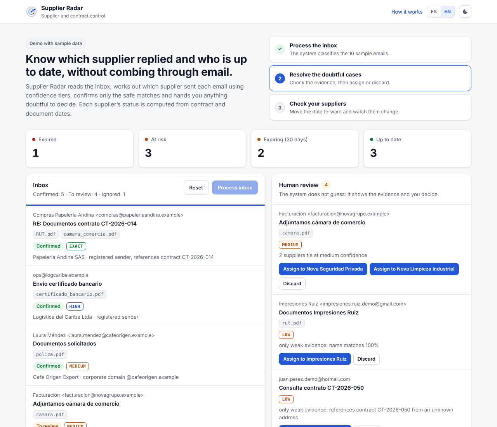
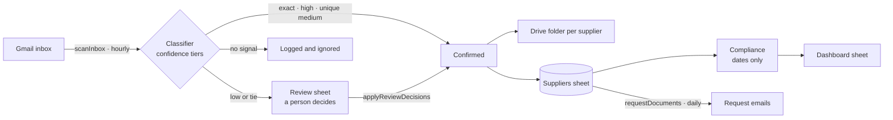

<div align="center">

# 📡 Supplier Radar

**Supplier and contract compliance automation on Google Workspace.**<br>
Confidence-tiered email matching · human-in-the-loop review · dashboards computed from dates only.

[](https://github.com/Dsergio909/supplier-radar/actions/workflows/ci.yml)


[**▶ Live demo**](https://dsergio909.github.io/supplier-radar/) · [How it works](docs/how-it-works.md) · [Cómo funciona (español)](docs/como-funciona.md)



</div>

## The problem

Keeping supplier documents and contracts up to date meant sending requests one by one, digging replies out of Gmail and trusting a spreadsheet "status" column that, in practice, nobody kept current.

I saw this problem first-hand during my procurement internship. Supplier Radar is an independent project that solves it on Google Workspace, with no budget and no paid tools. Everything here is original, tested and runs on fictional data.

The full walkthrough, from the matching rules to installing it in a Google Sheet, is in **[How it works](docs/how-it-works.md)** ([español](docs/como-funciona.md)).

## What it does

1. **Requests documents.** Emails every supplier that has not been asked yet, from a template.
2. **Reads the replies.** Classifies each new inbox message with confidence tiers (below) and logs every decision with its evidence.
3. **Files what is certain.** Attachments from confirmed replies are saved to a Drive folder per supplier and the received date is recorded.
4. **Asks a human about the rest.** Ambiguous emails land in a review sheet with the evidence and candidate suppliers. A person types the right supplier id and the script applies it.
5. **Shows the real picture.** A dashboard of expired, at-risk, expiring and up-to-date suppliers, computed from dates only.

## How the matching works

| Tier | Evidence | Outcome |
|---|---|---|
| `exact` | Registered sender **and** the contract number in the email | Confirmed automatically |
| `high` | Registered sender | Confirmed automatically |
| `medium` | The supplier's corporate domain (gmail.com, hotmail.com and similar never count) | Confirmed if only one supplier matches |
| `low` | A similar company name, or a contract number sent from an unknown address | **Always** human review |

If two suppliers match at the same top tier, for example two companies of one group sharing a domain, the email goes to review. The system never guesses.

And no match is ever confirmed if Gmail could not authenticate the sender (SPF/DMARC). A forged "From" asking to change a supplier's bank account goes straight to a person, with a warning.

## Design decisions

- **Precision over recall.** A wrong automatic confirmation silently marks a supplier as compliant. A false "needs review" costs a person ten seconds. So only strong, unique evidence is automated.
- **Dates, not status fields.** Status is derived from contract end, request and reply dates. The manual status column is ignored, and the demo highlights where it has drifted from reality.
- **One logic, three runtimes.** `src/core` is plain JavaScript with no dependencies. It is loaded unchanged by Node (tests), the browser (demo) and Google Apps Script (production).
- **Explainable by design.** Every decision carries structured evidence (`{ code, ...params }`), rendered in Spanish or English for the audit log, the review sheet and the demo.
- **Zero paid tools.** Only Google Workspace built-ins: no Zapier, no Make, no external APIs.

## Security

| Risk | Mitigation |
|---|---|
| Spoofed sender (fake supplier, e.g. bank-account change fraud) | Automatic confirmation requires Gmail's SPF or DMARC `pass`; otherwise the email goes to human review marked "possible spoofing". |
| Formula injection: an email subject like `=IMPORTXML(...)` running in the sheet | Every email-controlled value is written as plain text. |
| Duplicate or racing executions (hourly trigger + manual run) | A script lock allows one execution at a time, and each message id is processed only once. |
| Leaking real data from this public repo | All names, addresses and contracts are fictional. Corporate domains use the reserved `.example` TLD. No company code or data. |
| Demo page (XSS, third parties) | Content is rendered with `textContent` only; a strict Content-Security-Policy allows scripts, styles and fonts from the site itself, nothing else (fonts are self-hosted). No cookies, trackers or forms; only the light/dark choice is remembered in the browser. |
| CI supply chain | Workflows use read-only permissions and do not persist credentials; the project has zero npm dependencies. |

Known limit: the classifier reads text, not attachment contents. Someone who controls a supplier's real mailbox can still send documents, which is why the audit log keeps every decision.

## Architecture



## Project structure

```
src/core/classifier.js   confidence-tier matching
src/core/compliance.js   date-derived status and KPIs
src/core/messages.js     human-readable explanations (ES / EN)
src/data/sample.js       synthetic suppliers and emails
apps-script/Code.js      Gmail · Sheets · Drive adapter
apps-script/core_*.js    copies of src/core, ready to paste (a test keeps them in sync)
apps-script/*.csv        template for the Proveedores sheet
demo/                    interactive browser demo
docs/                    how it works, in Spanish and English
tests/                   unit tests, plus the Apps Script adapter run end-to-end
                         against in-memory fakes of SpreadsheetApp, GmailApp and DriveApp
```

## Run it

Requires Node 22+ and nothing else: there are no dependencies to install.

```bash
npm test          # runs the whole suite
```

To try the demo locally, serve the repository root (for example `npx http-server .`) and open `/demo/`.

### Install it in Google Sheets

No Node needed: the `apps-script/` folder is ready to paste.

1. Create a Google Sheet with a tab named `Proveedores`. Import [`apps-script/Proveedores-plantilla.csv`](apps-script/Proveedores-plantilla.csv) to get the headers, then replace the example rows with your suppliers. Use the status codes `expired`, `at-risk`, `expiring` or `active` in `manualStatus`, or leave it empty.
2. In the sheet, open **Extensions → Apps Script** and create one script file per `.js` file in `apps-script/` (`Code.js` and the three `core_*.js`), pasting its contents. If you use [clasp](https://github.com/google/clasp), push that folder instead.
3. Optional: add a script property `DRIVE_FOLDER_ID` with the id of the Drive folder where documents should be filed.
4. Reload the sheet and use the new **Supplier Radar** menu. **Instalar ejecución automática** scans the inbox every hour and sends requests every day.

If you change `src/core`, run `npm run build:gas` to refresh the copies; the test suite fails until you do.

## Roadmap

- **AI-assisted review.** For low-confidence cases, an LLM summarises the email and suggests a supplier as a hint. The decision stays human.
- Detect the document type (tax ID, bank certificate, etc.) from each attachment.
- Remind suppliers automatically before their contract expires.

## About

Built by **Sergio García**, an International Business graduate (diploma pending) based in Bogotá who likes turning repetitive work into automated systems. I don't come from engineering: I learned to code by building, using generative AI as a pair programmer. Supplier Radar was built with Claude Code: I designed the rules and reviewed every decision.

[Portfolio](https://dsergio909.github.io/) · [LinkedIn](https://linkedin.com/in/sergio-david-garcia-celis-836b8a250) · [dsergio909@gmail.com](mailto:dsergio909@gmail.com)

---

## 🇪🇸 Resumen en español

**Supplier Radar** automatiza el seguimiento de proveedores y contratos sobre Google Workspace (Sheets, Gmail y Drive), sin herramientas de pago.

- **Solicita documentos** a los proveedores por correo, con plantilla.
- **Lee las respuestas** y decide qué proveedor escribió usando **niveles de confianza**: `exact`, `high`, `medium` y `low`.
- **Detecta suplantaciones.** Si Gmail no puede verificar al remitente (SPF/DMARC), nunca confirma: lo manda a revisión con una alerta.
- **Confirma solo lo seguro.** Los casos ambiguos, como un nombre parecido o dos proveedores con el mismo dominio, pasan a una **hoja de revisión humana** con la evidencia.
- **Archiva los adjuntos** en Drive, en una carpeta por proveedor.
- **El tablero se calcula solo con fechas**: vencidos, en riesgo, por vencer y al día. No depende de columnas de estado que nadie actualiza.

Todos los datos son ficticios (dominios `.example`). Es un proyecto independiente, con pruebas automáticas, que nace de un problema que vi en mis prácticas de compras. [Ver la demo en vivo](https://dsergio909.github.io/supplier-radar/) · [Cómo funciona, paso a paso](docs/como-funciona.md).

## License

[MIT](LICENSE)
